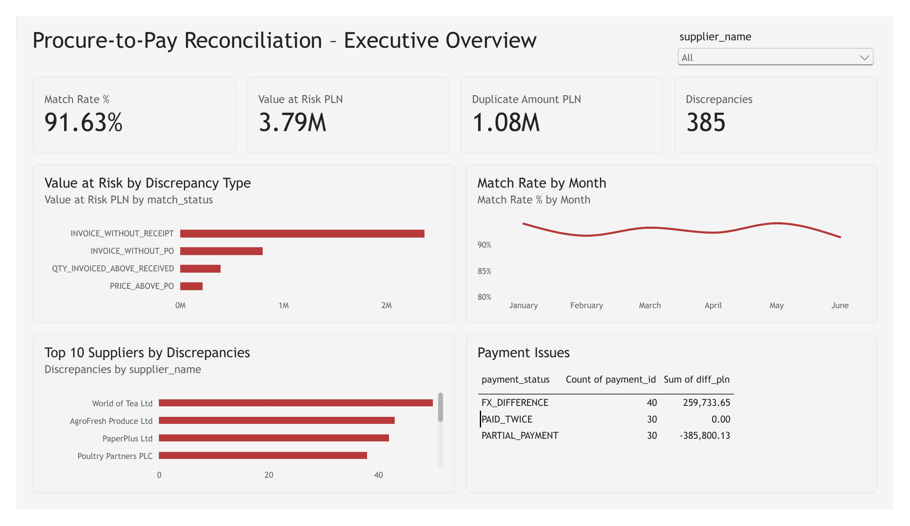
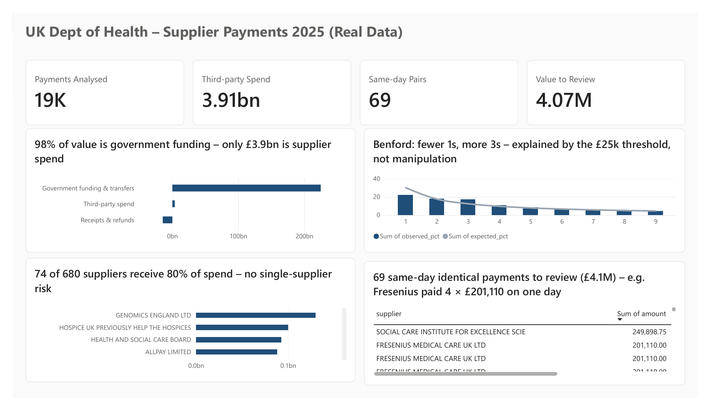

# Procure-to-Pay Reconciliation

**SQL (PostgreSQL) · Python (pandas) · Power BI · DAX**

An end-to-end reconciliation of purchase orders, goods receipts, supplier invoices and bank payments – the "3-way match" control used in Accounts Payable and tested in financial audits.

The project has two parts:

- **Part A – Reconciliation (synthetic data):** the full 3-way match + bank reconciliation, validated against an answer key of planted errors.
- **Part B – Audit analytics (real data):** the same audit mindset applied to **18,819 real supplier payments (£214.7bn)** published by the UK Department of Health and Social Care for 2025.



---

## Part A – Reconciliation (synthetic data)

### Business problem

At quarter-end close, internal audit at a (fictional) FMCG distributor noticed that **payments to suppliers exceeded the value of goods received**. Procurement said the orders were correct, Accounting said it paid according to invoices – but nobody had compared the four systems document by document.

**Goal:** match every payment to an invoice, goods receipt and purchase order, quantify mismatches in PLN, separate real losses from timing delays, and recommend permanent controls.

### Key results

| Metric | Result |
| --- | --- |
| Purchase orders passing 3-way match | **91.6%** (2,790 of 3,045) |
| Invoiced value at risk | **3.79M PLN** (3.2% of 116.7M PLN invoiced) |
| Duplicate invoices paid twice | **30 invoices, 1.08M PLN** |
| Overpayment from a stale EUR rate | **0.26M PLN** on 40 payments |
| Payments matched automatically | **99.5%** (SQL exact match + Python fuzzy match) |
| Payments with no invoice at all | **15 transfers, 0.29M PLN** |

### Insights

1. **Paying for goods that never arrived is the biggest risk.** 60 invoices without a goods receipt account for **2.37M PLN – 63% of the value at risk**.
2. **Duplicates are rare but expensive.** Only 1% of invoices, yet 1.08M PLN – and every złoty is recoverable from suppliers.
3. **The problem is concentrated.** Three suppliers (World of Tea, AgroFresh Produce, PaperPlus) cause **35% of all discrepancies**, so targeted supplier reviews give the fastest return.
4. **Not every mismatch is a loss.** 100 orders only had the goods receipt registered late, and 70 were partial deliveries invoiced correctly. Flagging them as errors would waste the team's time.
5. **Off-process purchasing exists.** 45 invoices (0.80M PLN) have no purchase order at all, so they bypass the approval process.
6. **One hard-coded value costs money.** Converting EUR at a fixed 4.50 instead of the daily rate caused a systematic overpayment of 0.26M PLN.
7. **Match rate is stable at ~92% every month** – this is a process gap, not a one-off incident.

### Recommendations

1. Enforce automatic 3-way match: no invoice is released for payment without a PO and a goods receipt.
2. Block duplicate invoice numbers per supplier at booking.
3. Introduce a price tolerance (e.g. 1%) with buyer approval above it.
4. Pull FX rates automatically (NBP) for the payment date – no hard-coded values.
5. Require the invoice number in the transfer title in supplier contracts.
6. Separate approval path for advances and "urgent" payments without an invoice.
7. Replace the quarterly review with a weekly automated reconciliation report.

### Approach

```
CSV data ──► PostgreSQL ──► SQL reconciliation ──► Python fuzzy matching ──► Power BI
(6 tables)   (schema,       (views, CTEs,          & validation against      (star schema,
              keys)          window functions)      an answer key            DAX measures)
```

| Step | What | Techniques |
| --- | --- | --- |
| 1. Data | 6 related tables, 13 planted issue types (incl. 3 deliberate "false alarms") | Python, pandas, NumPy |
| 2. Database | Schema with primary/foreign keys, constraints and indexes | PostgreSQL |
| 3. Reconciliation | 3-way match, duplicate detection, payment matching, monthly trend, supplier ranking | `FULL OUTER JOIN`, `LEFT JOIN … IS NULL`, CTEs, `ROW_NUMBER`, `RANK`, `UNION ALL`, views |
| 4. Fuzzy matching | Payments without an invoice number matched by supplier name similarity, amount (±2%) and date window | rapidfuzz / difflib, pandas |
| 5. Validation | Results compared with an answer key of planted errors – recall and precision per issue type | pandas |
| 6. Dashboard | Star schema (1 dimension, 4 facts), DAX measures, Top N filters, supplier slicer | Power BI, DAX |

### Validation

Because the dataset is synthetic, every planted error is known. The method was tested against this answer key:

| Issue type | Planted | Found | Recall | Precision |
| --- | --- | --- | --- | --- |
| Invoice without goods receipt | 60 | 60 | 100% | 100% |
| Quantity invoiced above received | 90 | 90 | 100% | 100% |
| Price above PO | 60 | 60 | 100% | 100% |
| Invoice without PO | 45 | 45 | 100% | 100% |
| Duplicate invoice | 30 | 30 | 100% | 100% |
| Stale FX rate | 40 | 40 | 100% | 100% |
| Partial payment | 30 | 30 | 100% | 100% |
| Payment without invoice reference | 120 | 120 | 100% | 100% |
| Payment without any invoice | 15 | 15 | 100% | 100% |

### Data

The data is **synthetic**, generated by `python/generate_data.py` (fixed random seed, so results are reproducible). Suppliers, invoices and amounts are fictional. Using generated data with known errors is what makes it possible to measure how accurate the reconciliation is.

| Table | Source system | Rows |
| --- | --- | --- |
| `purchase_orders` | ERP purchasing | 3,000 |
| `goods_receipts` | Warehouse (WMS) | 2,940 |
| `supplier_invoices` | Accounts Payable | 3,075 |
| `bank_payments` | Bank statement | 3,000 |
| `suppliers` | Master data | 40 |
| `fx_rates` | Daily EUR/PLN | 271 |

## Part B – Audit analytics on real data (UK Department of Health, 2025)

**Source:** [DHSC spending over £25,000](https://www.gov.uk/government/collections/dhsc-spending-over-25000) – every payment above £25,000 made by the UK Department of Health and Social Care, published monthly as open data (Open Government Licence v3.0). Twelve monthly files for 2025 were downloaded, cleaned and combined by `python/download_gov_spend.py`; the tests are in `python/analyze_gov_spend.py`.

| Metric | Result |
| --- | --- |
| Payments analysed | **18,819** (Jan–Dec 2025) |
| Total value | **£214.7bn** net of receipts |
| Of which real third-party spend | **£3.9bn (1.7%)** in 11,668 payments |
| Named suppliers (third-party) | **680** |
| Same-day identical payments to review | **69 pairs, £4.1M** |



### Step 1 – Understand the data before testing it

The first run showed **one "supplier" receiving 93% of all money** and 815 "duplicate" payments. Both were misleading: the file mixes **budget transfers inside government** (e.g. £199bn to NHS England, funding of agencies, capital and loans to NHS trusts) with **real purchases from suppliers**. Running audit tests on budget transfers produces noise, so payments were first segmented:

| Segment | Payments | Value | Share |
| --- | --- | --- | --- |
| Government funding & transfers | 5,743 | £225.1bn | 98.3% |
| Third-party spend | 11,668 | £3.9bn | 1.7% |
| Receipts & refunds (negative) | 1,408 | –£14.3bn | – |

All tests below run on **third-party spend only**.

### Findings

1. **Supplier concentration is moderate.** 74 of 680 suppliers (10.9%) receive 80% of third-party spend; the largest (Genomics England) has only 4.7%, so there is no single-supplier dependency.
2. **Most "duplicates" are recurring payments, not errors.** Of 581 pairs with the same supplier and amount within 30 days, 321 follow a monthly pattern (contracts, fees). The review list is narrowed to **69 same-day pairs (£4.1M)** with different transaction numbers.
3. **Top item to review:** Fresenius Medical Care UK – **four payments of £201,110 on the same day** (10 Sep 2025) with different transaction numbers. This may be four separate invoices, but it is exactly the kind of item an auditor would ask the AP team to explain.
4. **A whole block of funding transfers appears twice on 3 March 2025** – NHS England £11.6bn ×2, NHSBSA £39M ×2, MHRA £10M ×2 (73 same-day identical funding payments, £23.4bn). Most likely two planned drawdowns before financial year-end, but worth confirming.
5. **Round amounts are explainable.** 3.8% of third-party payments are exact multiples of £10,000, mostly research grants, which are awarded in round sums.
6. **Benford's law shows "nonconformity" (MAD 0.018) – but this is a limitation of the data, not a red flag.** The file only contains payments above £25,000, so amounts starting with 1 (£10–19k) are cut off and amounts starting with 3 (£30–39k) are over-represented. Knowing when a test does *not* apply is part of using it correctly.
7. **Data quality is good:** 276 payments (£1.17bn) have the supplier withheld for personal-data reasons; only 0.6% lack a transaction number.

## How to run

The project includes a command-line runner (`run.py`) so workflows can be started from the repository root without changing directories. Python 3.12 or newer is required by the pinned NumPy version. Dependencies, including transitive dependencies, are pinned in [`requirements.txt`](requirements.txt).

```bash
# Create and activate a virtual environment (macOS/Linux)
python3 -m venv .venv
source .venv/bin/activate
python -m pip install -r requirements.txt

# Run the local Part A demo: generate data, validate it, and run the SQL analysis
python run.py demo
```

Run individual workflows with the same runner:

```bash
python run.py generate                     # create synthetic CSVs in data/
python run.py validate                     # fuzzy-match payments and check answer key
python run.py sql                          # analyze data/ with SQLite (no server needed)
python run.py sql --save                   # also save the SQLite database as p2p.db
python run.py download                     # download the 2025 DHSC spending data
python run.py download 2024                # download another year
python run.py analyze                      # analyze the downloaded 2025 data
python run.py analyze 2024                 # analyze another downloaded year
python run.py xes /path/to/log.xes.gz      # optional BPI XES-to-CSV conversion
```

`validate`, `sql`, and `analyze` need their corresponding input data first. `download` accesses GOV.UK over the network. The runner uses the Python interpreter that starts it, so activate `.venv` before running commands.

### Optional: PostgreSQL and Power BI

For the server-backed SQL workflow, generate the data first, then run:

```bash
createdb p2p
psql -d p2p -f sql/01_schema.sql
psql -d p2p -f sql/02_load.sql
psql -d p2p -f sql/reconciliation.sql
psql -d p2p -f sql/03_export_powerbi.sql
```

Then open `powerbi/p2p_reconciliation.pbix` in Power BI Desktop.

## Repository structure

```
p2p-reconciliation/
├── python/
│   ├── generate_data.py      # synthetic data + answer key
│   ├── validate.py           # fuzzy matching + validation
│   ├── run_sql.py            # run SQL on SQLite (no server needed)
│   ├── download_gov_spend.py # Part B: download + clean real DHSC payments
│   ├── analyze_gov_spend.py  # Part B: segmentation + audit tests
│   └── xes_to_csv.py         # converter for the BPI Challenge 2019 log (optional)
├── run.py                    # command-line runner for project workflows
├── requirements.txt          # exact Python dependency versions
├── sql/
│   ├── 01_schema.sql         # tables, keys, constraints, indexes
│   ├── 02_load.sql           # load CSVs
│   ├── reconciliation.sql    # 3-way match, duplicates, payments, trend, ranking
│   ├── 03_export_powerbi.sql # star-schema export for Power BI
│   └── bpi_compliance.sql    # compliance checks for the BPI 2019 log (optional)
├── real_data/                # Part B: combined 2025 data + test results
├── powerbi/                  # .pbix dashboard
└── images/                   # screenshots
```

## Next steps

- Aging analysis of unpaid invoices (overdue vs. not yet due).
- Sensitivity analysis of fuzzy-matching thresholds (precision vs. recall).
- Benford test on first-two digits, which is less affected by the £25,000 threshold.
- Extend Part B to several years and other departments to compare payment patterns.

---

**Author:** Maria Kurzeja · [GitHub](https://github.com/MarKurzeja)
